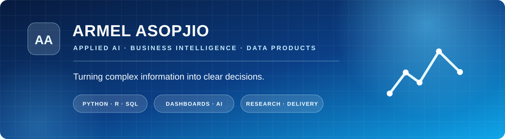
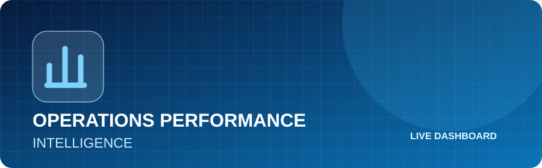
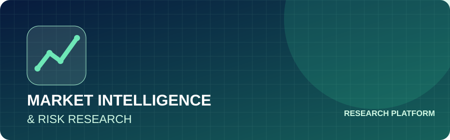

  

  &nbsp;&nbsp;
  &nbsp;&nbsp;
  &nbsp;&nbsp;
  

  
  

## About

I am a Data Science graduate and an M.S. Artificial Intelligence candidate at Northeastern University. I build decision-support products that turn complex operational data into clear, useful actions.

My work combines applied AI, business intelligence, interactive data applications, and quantitative research. I care about dependable data foundations, transparent assumptions, effective interfaces, and validation before claims.

## Selected projects

<table><tr>
<td width="33%" valign="top">

<h3>Operations Performance Intelligence</h3>

Executive analytics for commercial performance, supply chain, inventory, receivables, and operational decision-making.  

<b>R Shiny | Plotly | Data workflows</b>

  
<a href="https://github.com/Gad-Armel/Aurelis-Operations-Intelligence">Project repository -&gt;</a>
</td>
<td width="33%" valign="top">

<h3>Customer &amp; Service Intelligence</h3>

Business intelligence for multi-location service operations: revenue, appointments, retention, staff, inventory, and customer behavior.

<b>React | TypeScript | Analytics UX</b>

  
<a href="https://github.com/Gad-Armel/Aurelis-Beauty-Dashboard-Live">Project repository -&gt;</a>
</td>
<td width="33%" valign="top">

<h3>Market Intelligence &amp; Risk Research</h3>

Research-first platform for market analysis, risk controls, demo execution monitoring, and MQL5 workflow integration.  

<b>Python | MQL5 | MetaTrader 5</b>

Research and engineering project. Historical analysis does not establish future trading performance.

</td>
</tr></table>

## Professional toolkit

| Focus | Tools and methods |
|---|---|
| **Data analysis** | Python, R, SQL, pandas, NumPy, statistical analysis, exploratory data analysis, feature engineering, data quality checks |
| **Business intelligence** | Power BI, DAX, Power Query, Tableau, R Shiny, KPI design, forecasting, operational reporting, data storytelling |
| **Data engineering** | Relational data modeling, PostgreSQL, MySQL, ETL/ELT, APIs, dbt fundamentals, Airflow fundamentals, Docker fundamentals, cloud foundations |
| **Applied AI & ML** | scikit-learn, supervised learning, regression, classification, time series foundations, model evaluation, experiment design, LLM application fundamentals |
| **Product & applications** | React, TypeScript, JavaScript, Vite, HTML, CSS, responsive UI, accessibility, UX-oriented dashboard design |
| **Engineering delivery** | Git, GitHub, VS Code, RStudio, testing, documentation, reproducible workflows, agile collaboration |

Core tools and practical foundations across analytics, BI, data engineering, and applied AI.

## How I work

1. Start with the decision to improve and the people who will use the result.
2. Examine data quality, provenance, limitations, and missing context.
3. Build repeatable pipelines and applications with checks around important failure points.
4. Make findings understandable through focused visualisation and interaction.
5. Document what is implemented, what is demonstrated, and what still needs evidence.

## Education

<table><tr>
<td width="33%" valign="top">  <b>M.S. Artificial Intelligence</b> ALIGN program</td>
<td width="33%" valign="top">  <b>B.A. Data Science</b> Liberal arts and quantitative foundation</td>
<td width="33%" valign="top">  <b>International Baccalaureate Diploma</b> Mahindra United World College of India</td>
</tr></table>

<h2 align="center">Turn information into a decision advantage.</h2>

Let us build the data product, analytical workflow, or executive view that makes the next decision clearer.

<a href="https://www.linkedin.com/in/armel-asopjio/"><b>LinkedIn</b></a> &nbsp;|&nbsp; <a href="mailto:armelasopjio@gmail.com"><b>Email</b></a> &nbsp;|&nbsp; <a href="https://gad-armel.github.io/flyer/"><b>View flyer</b></a> &nbsp;|&nbsp; <a href="https://gad-armel.github.io/Armel.A_BI_Portfolio.pdf"><b>Download flyer</b></a>

